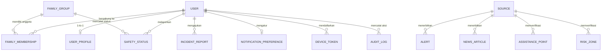

# Database Schema — SIGAP

**Versi:** 1.0  
**Status:** Draft untuk Diskusi Tim  
**Database:** PostgreSQL 15 + PostGIS (via Supabase Free Tier)  
**ORM:** GeoDjango (django.contrib.gis)

---

## Diagram Relasi Antar Tabel (ERD)



---

## Tabel-tabel Database

### 1. `auth_user` (Built-in Django, dikustomisasi)
Model custom turunan dari `AbstractBaseUser`.

| Kolom | Tipe | Constraint | Keterangan |
|---|---|---|---|
| `id` | UUID | PRIMARY KEY, default `gen_random_uuid()` | ID unik pengguna |
| `email` | VARCHAR(255) | UNIQUE, NOT NULL | Email sebagai username utama |
| `password` | VARCHAR(255) | NOT NULL | Hash Argon2 |
| `full_name` | VARCHAR(150) | NOT NULL | Nama lengkap |
| `role` | VARCHAR(20) | NOT NULL, default `'citizen'` | Enum: `citizen`, `officer`, `editor`, `superadmin` |
| `is_active` | BOOLEAN | default `TRUE` | Akun aktif atau dinonaktifkan |
| `is_staff` | BOOLEAN | default `FALSE` | Akses Django Admin |
| `date_joined` | TIMESTAMPTZ | NOT NULL, default `NOW()` | Waktu registrasi |
| `last_login` | TIMESTAMPTZ | NULLABLE | Login terakhir |

**Index:**
- `idx_users_email` pada kolom `email`
- `idx_users_role` pada kolom `role`

---

### 2. `user_profiles`
Ekstensi data profil opsional pengguna (relasi 1-to-1 dengan `auth_user`).

| Kolom | Tipe | Constraint | Keterangan |
|---|---|---|---|
| `id` | UUID | PRIMARY KEY | |
| `user_id` | UUID | FK → `auth_user.id`, UNIQUE, ON DELETE CASCADE | |
| `phone` | VARCHAR(20) | NULLABLE | Nomor telepon |
| `photo_url` | TEXT | NULLABLE | URL foto profil (Supabase Storage) |
| `primary_area` | VARCHAR(100) | NULLABLE, default `'Kota Padang'` | Wilayah utama pengguna |
| `address_note` | TEXT | NULLABLE | Keterangan alamat tambahan |
| `updated_at` | TIMESTAMPTZ | default `NOW()` | Terakhir diperbarui |

---

### 3. `notification_preferences`
Preferensi notifikasi per pengguna.

| Kolom | Tipe | Constraint | Keterangan |
|---|---|---|---|
| `id` | UUID | PRIMARY KEY | |
| `user_id` | UUID | FK → `auth_user.id`, UNIQUE, ON DELETE CASCADE | |
| `alert_enabled` | BOOLEAN | default `TRUE` | Notifikasi peringatan darurat |
| `news_enabled` | BOOLEAN | default `TRUE` | Notifikasi berita baru |
| `family_enabled` | BOOLEAN | default `TRUE` | Notifikasi update status keluarga |
| `updated_at` | TIMESTAMPTZ | default `NOW()` | |

---

### 4. `device_tokens`
Menyimpan FCM device token untuk push notification.

| Kolom | Tipe | Constraint | Keterangan |
|---|---|---|---|
| `id` | UUID | PRIMARY KEY | |
| `user_id` | UUID | FK → `auth_user.id`, ON DELETE CASCADE | |
| `fcm_token` | TEXT | NOT NULL | Token FCM dari Firebase SDK Flutter |
| `platform` | VARCHAR(10) | default `'android'` | Enum: `android`, `web` |
| `created_at` | TIMESTAMPTZ | default `NOW()` | |
| `last_used_at` | TIMESTAMPTZ | NULLABLE | Untuk pembersihan token expired |

**Index:**
- `idx_device_tokens_user_id` pada `user_id`
- `UNIQUE (user_id, fcm_token)` — satu token hanya terdaftar sekali per user

---

### 5. `sources`
Metadata sumber data terpercaya (BMKG, BPBD, dsb.).

| Kolom | Tipe | Constraint | Keterangan |
|---|---|---|---|
| `id` | UUID | PRIMARY KEY | |
| `name` | VARCHAR(200) | NOT NULL | Contoh: "BMKG Padang", "BPBD Kota Padang" |
| `source_url` | TEXT | NULLABLE | URL sumber resmi |
| `source_type` | VARCHAR(30) | NOT NULL | Enum: `government_api`, `government_manual`, `verified_media` |
| `description` | TEXT | NULLABLE | Keterangan sumber |
| `is_active` | BOOLEAN | default `TRUE` | Sumber masih valid |
| `checked_at` | TIMESTAMPTZ | NULLABLE | Terakhir diverifikasi |
| `created_at` | TIMESTAMPTZ | default `NOW()` | |

---

### 6. `alerts`
Peringatan bencana resmi (dari BMKG atau petugas BPBD).

| Kolom | Tipe | Constraint | Keterangan |
|---|---|---|---|
| `id` | UUID | PRIMARY KEY | |
| `source_id` | UUID | FK → `sources.id`, NULLABLE | Sumber data peringatan |
| `created_by_id` | UUID | FK → `auth_user.id`, NULLABLE | Jika dibuat manual oleh petugas |
| `disaster_type` | VARCHAR(30) | NOT NULL | Enum: `earthquake`, `tsunami`, `flood`, `landslide`, `extreme_weather` |
| `title` | VARCHAR(300) | NOT NULL | Judul singkat peringatan |
| `description` | TEXT | NOT NULL | Detail peringatan |
| `severity` | VARCHAR(20) | NOT NULL | Enum: `waspada`, `siaga`, `awas` |
| `status` | VARCHAR(20) | NOT NULL, default `'active'` | Enum: `active`, `expired`, `cancelled` |
| `affected_area` | VARCHAR(300) | NOT NULL | Deskripsi wilayah terdampak |
| `location` | GEOMETRY(Point, 4326) | NULLABLE | Koordinat episentrum/lokasi (PostGIS) |
| `source_reference_url` | TEXT | NULLABLE | Link ke sumber asli |
| `published_at` | TIMESTAMPTZ | NOT NULL | Waktu diterbitkan |
| `expires_at` | TIMESTAMPTZ | NULLABLE | Waktu kadaluarsa peringatan |
| `updated_at` | TIMESTAMPTZ | default `NOW()` | |
| `content_hash` | VARCHAR(64) | NULLABLE | SHA256 hash konten BMKG untuk deduplikasi |
| `is_from_bmkg` | BOOLEAN | default `FALSE` | Ditandai jika sumber otomatis dari BMKG API |

**Index:**
- `idx_alerts_status` pada `status`
- `idx_alerts_disaster_type` pada `disaster_type`
- `idx_alerts_published_at` pada `published_at DESC`
- `idx_alerts_location` menggunakan GIST index (PostGIS)

**Query Penting:**
```sql
-- Ambil peringatan aktif terbaru
SELECT * FROM alerts 
WHERE status = 'active' 
ORDER BY published_at DESC 
LIMIT 10;

-- Deduplikasi: cek apakah data BMKG sudah pernah masuk
SELECT id FROM alerts WHERE content_hash = $1 AND is_from_bmkg = TRUE;
```

---

### 7. `news_articles`
Portal berita kebencanaan Kota Padang.

| Kolom | Tipe | Constraint | Keterangan |
|---|---|---|---|
| `id` | UUID | PRIMARY KEY | |
| `source_id` | UUID | FK → `sources.id`, NULLABLE | Sumber artikel |
| `author_id` | UUID | FK → `auth_user.id`, NOT NULL | Penulis/editor yang menerbitkan |
| `title` | VARCHAR(400) | NOT NULL | Judul berita |
| `slug` | VARCHAR(450) | UNIQUE, NOT NULL | URL-friendly title (auto-generated) |
| `summary` | TEXT | NULLABLE | Ringkasan 1-2 kalimat |
| `content` | TEXT | NOT NULL | Isi berita (Markdown atau HTML) |
| `thumbnail_url` | TEXT | NULLABLE | URL gambar thumbnail (Supabase Storage) |
| `category` | VARCHAR(30) | NOT NULL | Enum: `earthquake`, `tsunami`, `flood`, `landslide`, `general` |
| `area_tags` | TEXT[] | NULLABLE | Array tag wilayah, misal `['Padang Barat', 'Bungus']` |
| `is_published` | BOOLEAN | default `FALSE` | Draft atau sudah dipublikasikan |
| `published_at` | TIMESTAMPTZ | NULLABLE | Waktu dipublikasikan |
| `created_at` | TIMESTAMPTZ | default `NOW()` | |
| `updated_at` | TIMESTAMPTZ | default `NOW()` | |

**Index:**
- `idx_news_is_published_published_at` pada `(is_published, published_at DESC)`
- `idx_news_category` pada `category`
- `idx_news_slug` pada `slug` (UNIQUE)

---

### 8. `assistance_points`
Titik bantuan terverifikasi: posko, rumah sakit, titik evakuasi.

| Kolom | Tipe | Constraint | Keterangan |
|---|---|---|---|
| `id` | UUID | PRIMARY KEY | |
| `source_id` | UUID | FK → `sources.id`, NULLABLE | Sumber/verifikator data |
| `name` | VARCHAR(300) | NOT NULL | Nama lokasi |
| `category` | VARCHAR(30) | NOT NULL | Enum: `evacuation_point`, `emergency_post`, `hospital`, `health_center`, `relief_point` |
| `address` | TEXT | NULLABLE | Alamat lengkap |
| `location` | GEOMETRY(Point, 4326) | NOT NULL | Koordinat GPS (**PostGIS Point, wajib**) |
| `phone` | VARCHAR(20) | NULLABLE | Nomor kontak terverifikasi |
| `operational_hours` | VARCHAR(100) | NULLABLE | Misal: "24 Jam" / "08.00 - 17.00" |
| `capacity` | INTEGER | NULLABLE | Kapasitas tampung (untuk titik evakuasi) |
| `verification_status` | VARCHAR(20) | NOT NULL, default `'unverified'` | Enum: `verified`, `unverified`, `outdated` |
| `verified_at` | TIMESTAMPTZ | NULLABLE | Waktu terakhir diverifikasi |
| `is_active` | BOOLEAN | default `TRUE` | Masih beroperasi |
| `notes` | TEXT | NULLABLE | Catatan tambahan |
| `created_at` | TIMESTAMPTZ | default `NOW()` | |
| `updated_at` | TIMESTAMPTZ | default `NOW()` | |

**Index:**
- `idx_assistance_location` — GIST index pada kolom `location` (PostGIS)
- `idx_assistance_category` pada `category`
- `idx_assistance_verification` pada `verification_status`

**Query Penting:**
```sql
-- Titik evakuasi dalam radius 5 km dari koordinat pengguna
SELECT name, category, address,
       ST_Distance(location::geography, ST_MakePoint(100.35, -0.95)::geography) AS distance_meters
FROM assistance_points
WHERE ST_DWithin(
    location::geography,
    ST_MakePoint(100.35, -0.95)::geography, -- (lon, lat) pengguna
    5000  -- radius dalam meter
)
AND category = 'evacuation_point'
AND is_active = TRUE
ORDER BY distance_meters ASC;
```

---

### 9. `risk_zones`
Zona risiko bencana Kota Padang dalam format Poligon (GeoJSON).

| Kolom | Tipe | Constraint | Keterangan |
|---|---|---|---|
| `id` | UUID | PRIMARY KEY | |
| `source_id` | UUID | FK → `sources.id`, NULLABLE | Sumber data zona risiko |
| `name` | VARCHAR(200) | NOT NULL | Nama zona/kawasan |
| `hazard_type` | VARCHAR(30) | NOT NULL | Enum: `earthquake`, `tsunami`, `flood`, `landslide` |
| `risk_level` | VARCHAR(20) | NOT NULL | Enum: `low`, `medium`, `high`, `very_high` |
| `geometry` | GEOMETRY(Polygon, 4326) | NOT NULL | Area zona risiko (**PostGIS Polygon**) |
| `description` | TEXT | NULLABLE | Keterangan zona |
| `source_notes` | TEXT | NULLABLE | Catatan sumber dan metodologi data |
| `updated_at` | TIMESTAMPTZ | default `NOW()` | Terakhir diperbarui |

**Index:**
- `idx_risk_zones_geometry` — GIST index pada `geometry` (PostGIS)
- `idx_risk_zones_hazard_type` pada `hazard_type`

---

### 10. `emergency_contacts`
Daftar kontak darurat resmi Kota Padang.

| Kolom | Tipe | Constraint | Keterangan |
|---|---|---|---|
| `id` | UUID | PRIMARY KEY | |
| `name` | VARCHAR(200) | NOT NULL | Nama layanan/instansi |
| `category` | VARCHAR(30) | NOT NULL | Enum: `police`, `bpbd`, `sar`, `hospital`, `fire`, `ambulance`, `other` |
| `phone_number` | VARCHAR(20) | NOT NULL | Nomor telepon terverifikasi |
| `description` | TEXT | NULLABLE | Keterangan layanan |
| `area` | VARCHAR(100) | NULLABLE | default `'Kota Padang'` |
| `is_verified` | BOOLEAN | default `FALSE` | Sudah diverifikasi atau belum |
| `verified_at` | TIMESTAMPTZ | NULLABLE | |
| `verified_by_id` | UUID | FK → `auth_user.id`, NULLABLE | Siapa yang verifikasi |
| `is_active` | BOOLEAN | default `TRUE` | |
| `sort_order` | INTEGER | default `0` | Urutan tampilan |

---

### 11. `guides`
Panduan kesiapsiagaan bencana (Sebelum/Saat/Sesudah).

| Kolom | Tipe | Constraint | Keterangan |
|---|---|---|---|
| `id` | UUID | PRIMARY KEY | |
| `disaster_type` | VARCHAR(30) | NOT NULL | Enum: `earthquake`, `tsunami`, `flood`, `landslide`, `general` |
| `phase` | VARCHAR(20) | NOT NULL | Enum: `before`, `during`, `after` |
| `title` | VARCHAR(300) | NOT NULL | Judul panduan |
| `content` | TEXT | NOT NULL | Isi panduan (Markdown, urutan langkah) |
| `icon_name` | VARCHAR(50) | NULLABLE | Nama icon untuk Flutter |
| `reviewed_source` | TEXT | NULLABLE | Sumber/referensi panduan |
| `reviewed_at` | DATE | NULLABLE | Tanggal peninjauan terakhir |
| `sort_order` | INTEGER | default `0` | Urutan tampilan |
| `is_published` | BOOLEAN | default `TRUE` | |
| `updated_at` | TIMESTAMPTZ | default `NOW()` | |

---

### 12. `family_groups`
Grup keluarga untuk pemantauan status keselamatan bersama.

| Kolom | Tipe | Constraint | Keterangan |
|---|---|---|---|
| `id` | UUID | PRIMARY KEY | |
| `name` | VARCHAR(150) | NOT NULL | Nama grup (misal: "Keluarga Bapak Andi") |
| `created_by_id` | UUID | FK → `auth_user.id`, NOT NULL | Pembuat grup (admin grup) |
| `invite_code` | CHAR(8) | UNIQUE, NOT NULL | Kode undangan unik (auto-generated) |
| `invite_code_expires_at` | TIMESTAMPTZ | NULLABLE | Kode expire setelah 24 jam, dapat di-regenerate |
| `created_at` | TIMESTAMPTZ | default `NOW()` | |

**Index:**
- `idx_family_groups_invite_code` pada `invite_code` (UNIQUE)

---

### 13. `family_memberships`
Relasi many-to-many antara pengguna dan grup keluarga.

| Kolom | Tipe | Constraint | Keterangan |
|---|---|---|---|
| `id` | UUID | PRIMARY KEY | |
| `family_group_id` | UUID | FK → `family_groups.id`, ON DELETE CASCADE | |
| `user_id` | UUID | FK → `auth_user.id`, ON DELETE CASCADE | |
| `role` | VARCHAR(20) | NOT NULL, default `'member'` | Enum: `admin` (pembuat), `member` |
| `joined_at` | TIMESTAMPTZ | default `NOW()` | Waktu bergabung |

**Constraint:**
- `UNIQUE (family_group_id, user_id)` — satu user tidak bisa bergabung dua kali di grup yang sama

---

### 14. `safety_statuses`
Riwayat laporan status keselamatan anggota keluarga.

| Kolom | Tipe | Constraint | Keterangan |
|---|---|---|---|
| `id` | UUID | PRIMARY KEY | |
| `family_group_id` | UUID | FK → `family_groups.id`, ON DELETE CASCADE | |
| `user_id` | UUID | FK → `auth_user.id`, ON DELETE CASCADE | |
| `status` | VARCHAR(20) | NOT NULL | Enum: `safe`, `need_help`, `unknown` |
| `message` | TEXT | NULLABLE | Pesan tambahan dari pengguna |
| `location` | GEOMETRY(Point, 4326) | NULLABLE | Koordinat saat lapor (hanya jika dibagikan eksplisit) |
| `location_note` | TEXT | NULLABLE | Keterangan lokasi teks (misal: "Di rumah nenek, Tabing") |
| `battery_level` | SMALLINT | NULLABLE | Level baterai perangkat (0-100) |
| `created_at` | TIMESTAMPTZ | default `NOW()` | Waktu laporan dikirim |

**Index:**
- `idx_safety_statuses_family_user` pada `(family_group_id, user_id)`
- `idx_safety_statuses_created_at` pada `created_at DESC`

**Query Penting:**
```sql
-- Status terbaru setiap anggota di suatu grup
SELECT DISTINCT ON (user_id) 
    user_id, status, message, location_note, battery_level, created_at
FROM safety_statuses
WHERE family_group_id = $1
ORDER BY user_id, created_at DESC;
```

---

### 15. `incident_reports` (P1 — Post MVP)
Laporan kejadian dari masyarakat, perlu dimoderasi sebelum dipublikasikan.

| Kolom | Tipe | Constraint | Keterangan |
|---|---|---|---|
| `id` | UUID | PRIMARY KEY | |
| `user_id` | UUID | FK → `auth_user.id`, ON DELETE SET NULL | Pelapor |
| `category` | VARCHAR(30) | NOT NULL | Enum: `earthquake`, `flood`, `landslide`, `tsunami`, `other` |
| `description` | TEXT | NOT NULL | Deskripsi kejadian |
| `location` | GEOMETRY(Point, 4326) | NULLABLE | Koordinat lokasi kejadian |
| `location_note` | TEXT | NULLABLE | Keterangan lokasi teks |
| `media_url` | TEXT | NULLABLE | URL foto (Supabase Storage) |
| `incident_time` | TIMESTAMPTZ | NULLABLE | Waktu kejadian dilaporkan pengguna |
| `moderation_status` | VARCHAR(20) | NOT NULL, default `'pending'` | Enum: `pending`, `verified`, `rejected`, `closed` |
| `reviewed_by_id` | UUID | FK → `auth_user.id`, NULLABLE | Petugas yang mereview |
| `review_notes` | TEXT | NULLABLE | Catatan reviewer |
| `created_at` | TIMESTAMPTZ | default `NOW()` | |
| `updated_at` | TIMESTAMPTZ | default `NOW()` | |

---

### 16. `audit_logs` (Admin)
Catatan perubahan penting yang dilakukan admin/petugas.

| Kolom | Tipe | Constraint | Keterangan |
|---|---|---|---|
| `id` | UUID | PRIMARY KEY | |
| `actor_id` | UUID | FK → `auth_user.id`, NULLABLE | Siapa yang melakukan aksi |
| `action` | VARCHAR(50) | NOT NULL | Contoh: `create_alert`, `verify_report`, `update_posko` |
| `entity_type` | VARCHAR(50) | NOT NULL | Nama model/tabel yang berubah |
| `entity_id` | UUID | NULLABLE | ID record yang berubah |
| `details` | JSONB | NULLABLE | Detail perubahan (old value → new value) |
| `created_at` | TIMESTAMPTZ | default `NOW()` | |

---

## Ringkasan Tabel

| No | Nama Tabel | Prioritas | Keterangan |
|---|---|---|---|
| 1 | `auth_user` | P0 | Akun pengguna (custom model Django) |
| 2 | `user_profiles` | P0 | Profil opsional |
| 3 | `notification_preferences` | P0 | Preferensi notifikasi |
| 4 | `device_tokens` | P0 | FCM token untuk push notification |
| 5 | `sources` | P0 | Metadata sumber data terpercaya |
| 6 | `alerts` | P0 | Peringatan bencana resmi + BMKG |
| 7 | `news_articles` | P0 | Berita kebencanaan Padang |
| 8 | `assistance_points` | P0 | Posko, titik evakuasi, rumah sakit (GIS) |
| 9 | `risk_zones` | P0 | Zona risiko bencana (GIS Polygon) |
| 10 | `emergency_contacts` | P0 | Kontak darurat resmi |
| 11 | `guides` | P0 | Panduan kesiapsiagaan |
| 12 | `family_groups` | P0 | Grup keluarga |
| 13 | `family_memberships` | P0 | Relasi user ↔ grup keluarga |
| 14 | `safety_statuses` | P0 | Status keselamatan anggota keluarga |
| 15 | `incident_reports` | P1 | Laporan warga (post-MVP) |
| 16 | `audit_logs` | P1 | Audit trail admin |

