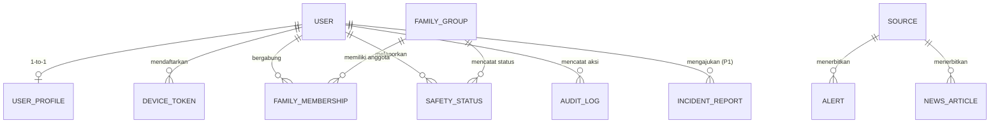

# Database Schema — SIGAP

**Versi:** 2.0 (hasil audit 11 Februari 2026)
**Database:** PostgreSQL 15 via Supabase Free Tier
**ORM:** **Django ORM** (tanpa PostGIS/GeoDjango)
**Primary key:** UUID (`uuid.uuid4`) pada semua tabel

---

## Perubahan dari Versi 1.0

| # | Perubahan | Alasan |
|---|---|---|
| 1 | `auth_user` → **`accounts_user`** | Nama tabel hasil model custom Django |
| 2 | `geometry` PostGIS → **`latitude`/`longitude` FloatField** | Tanpa GDAL/PostGIS |
| 3 | `risk_zones.geometry` Polygon → **`geojson` JSONField** | Flutter hanya merender |
| 4 | `family_memberships.role` → **`is_group_admin`** + **`status`** | Hindari tabrakan dengan RBAC, dukung approval |
| 5 | `safety_statuses.status` tanpa `unknown` | `unknown` = tidak ada baris |
| 6 | `device_tokens` → **`UNIQUE(fcm_token)`** | Satu device tidak boleh terdaftar ganda |
| 7 | `notification_preferences` → kolom di **`user_profiles`** | Hemat 1 tabel + 2 endpoint |
| 8 | `alerts.content_hash` → **`UNIQUE(source_id, bmkg_datetime)`** | Deduplikasi lebih andal |
| 9 | `audit_logs` P1 → **P0** | NFR-09 |
| 10 | `incident_reports` → P1, tanpa PostGIS | Ditunda ke Fase 4 |
| 11 | Kode undangan **CHAR(8)** di semua tempat | Sebelumnya 6 vs 8 vs 7 |

---

## Enum Terpusat

Setiap enum didefinisikan **sekali** sebagai `models.TextChoices` di model pemiliknya.

| Enum | Nilai | Pemilik |
|---|---|---|
| `Role` | `citizen`, `officer`, `editor`, `superadmin` | `accounts_user` |
| `DisasterType` | `earthquake`, `tsunami`, `flood`, `landslide`, `extreme_weather`, `general` | `alerts`, `news`, `guides` (subset sesuai konteks) |
| `Severity` | `waspada`, `siaga`, `awas` (nullable) | `alerts` |
| `AlertStatus` | `active`, `expired`, `cancelled` | `alerts` |
| `PointCategory` | `evacuation_point`, `emergency_post`, `hospital`, `health_center`, `relief_point` | `assistance_points` |
| `VerificationStatus` | `verified`, `unverified`, `outdated` | `assistance_points` |
| `HazardType` | `earthquake`, `tsunami`, `flood`, `landslide` | `risk_zones` |
| `RiskLevel` | `low`, `medium`, `high`, `very_high` | `risk_zones` |
| `ContactCategory` | `police`, `bpbd`, `sar`, `hospital`, `fire`, `ambulance`, `other` | `emergency_contacts` |
| `GuidePhase` | `before`, `during`, `after` | `guides` |
| `MembershipStatus` | `pending`, `active`, `rejected` | `family_memberships` |
| `SafetyStatusValue` | `safe`, `need_help` | `safety_statuses` |
| `ModerationStatus` | `pending`, `verified`, `rejected`, `closed` | `incident_reports` |

> `alerts.disaster_type` memakai 5 nilai (tanpa `general`). `news` memakai 5 nilai (tanpa `extreme_weather`). `guides` memakai 5 nilai (tanpa `extreme_weather`, dengan `general`). Filter API menyebut daftar sesuai modelnya.

---

## ERD



---

## 1. `accounts_user`

Model custom `AbstractBaseUser` + `PermissionsMixin`.

| Kolom | Tipe | Constraint | Keterangan |
|---|---|---|---|
| `id` | UUID | PK | — |
| `email` | VARCHAR(255) | UNIQUE, NOT NULL | Login identifier |
| `password` | VARCHAR(255) | NOT NULL | Hash Argon2 |
| `full_name` | VARCHAR(150) | NOT NULL | — |
| `role` | VARCHAR(20) | NOT NULL, default `citizen` | `Role` |
| `is_active` | BOOLEAN | default TRUE | — |
| `is_staff` | BOOLEAN | default FALSE | Akses Django Admin |
| `date_joined` | TIMESTAMPTZ | auto | — |
| `last_login` | TIMESTAMPTZ | NULL | — |

**Index:** `email` (UNIQUE), `role`

**Catatan:** `USERNAME_FIELD = 'email'`, `REQUIRED_FIELDS = ['full_name']`.

---

## 2. `user_profiles`

1-to-1 dengan user. Termasuk preferensi notifikasi (digabung agar tidak perlu tabel & endpoint terpisah).

| Kolom | Tipe | Constraint | Keterangan |
|---|---|---|---|
| `id` | UUID | PK | — |
| `user_id` | UUID | FK → `accounts_user`, UNIQUE, ON DELETE CASCADE | — |
| `phone` | VARCHAR(20) | NULL | — |
| `photo_url` | TEXT | NULL | Supabase Storage |
| `primary_area` | VARCHAR(100) | NULL | Default `Kota Padang` |
| `address_note` | TEXT | NULL | — |
| `alert_enabled` | BOOLEAN | default TRUE | Notifikasi peringatan darurat |
| `news_enabled` | BOOLEAN | default TRUE | Notifikasi berita |
| `family_enabled` | BOOLEAN | default TRUE | Notifikasi status keluarga |
| `updated_at` | TIMESTAMPTZ | auto | — |

---

## 3. `device_tokens`

| Kolom | Tipe | Constraint | Keterangan |
|---|---|---|---|
| `id` | UUID | PK | — |
| `user_id` | UUID | FK → `accounts_user`, ON DELETE CASCADE | — |
| `fcm_token` | TEXT | **UNIQUE**, NOT NULL | Satu device satu token |
| `platform` | VARCHAR(10) | default `android` | `android`, `web` |
| `created_at` | TIMESTAMPTZ | auto | — |
| `last_used_at` | TIMESTAMPTZ | NULL | Untuk pembersihan token mati |

**Perilaku:** saat register token, `update_or_create(fcm_token=..., defaults={'user_id': user})` — device yang berganti akun ikut berpindah.

---

## 4. `sources`

Metadata sumber data terpercaya.

| Kolom | Tipe | Constraint | Keterangan |
|---|---|---|---|
| `id` | UUID | PK | — |
| `name` | VARCHAR(200) | NOT NULL, UNIQUE | `BMKG`, `BPBD Kota Padang`, dst. |
| `source_url` | TEXT | NULL | — |
| `source_type` | VARCHAR(30) | NOT NULL | `government_api`, `government_manual`, `verified_media` |
| `description` | TEXT | NULL | — |
| `is_active` | BOOLEAN | default TRUE | — |
| `checked_at` | TIMESTAMPTZ | NULL | Terakhir diverifikasi |
| `created_at` | TIMESTAMPTZ | auto | — |

---

## 5. `alerts`

Peringatan bencana dari BMKG (gempa) atau petugas BPBD.

| Kolom | Tipe | Constraint | Keterangan |
|---|---|---|---|
| `id` | UUID | PK | — |
| `source_id` | UUID | FK → `sources`, NULL | — |
| `created_by_id` | UUID | FK → `accounts_user`, NULL | Terisi jika manual |
| `disaster_type` | VARCHAR(30) | NOT NULL | `earthquake`, `tsunami`, `flood`, `landslide`, `extreme_weather` |
| `title` | VARCHAR(300) | NOT NULL | — |
| `description` | TEXT | NOT NULL | — |
| `severity` | VARCHAR(20) | **NULL** | `waspada`/`siaga`/`awas`. `NULL` untuk data BMKG |
| `status` | VARCHAR(20) | NOT NULL, default `active` | `active`, `expired`, `cancelled` |
| `affected_area` | VARCHAR(300) | NOT NULL | Teks wilayah dari sumber |
| `latitude` | FLOAT | NULL | Episentrum / lokasi |
| `longitude` | FLOAT | NULL | — |
| `depth_km` | SMALLINT | NULL | Khusus gempa |
| `magnitude` | FLOAT | NULL | Khusus gempa |
| `felt_description` | VARCHAR(300) | NULL | Field `Dirasakan` BMKG (MMI) |
| `source_reference_url` | TEXT | NULL | — |
| `published_at` | TIMESTAMPTZ | NOT NULL | — |
| `expires_at` | TIMESTAMPTZ | NULL | — |
| `bmkg_datetime` | TIMESTAMPTZ | NULL | Untuk deduplikasi |
| `is_from_bmkg` | BOOLEAN | default FALSE | — |
| `created_at` | TIMESTAMPTZ | auto | — |
| `updated_at` | TIMESTAMPTZ | auto | — |

**Constraint:** `UNIQUE(source_id, bmkg_datetime)` — deduplikasi data BMKG. Data manual tidak terpengaruh karena `bmkg_datetime` NULL (unik diizinkan untuk NULL ganda di PostgreSQL).

**Index:** `status`, `disaster_type`, `published_at DESC`, `(is_from_bmkg, bmkg_datetime)`

**Query penting:**

```sql
-- Peringatan aktif terbaru
SELECT * FROM alerts WHERE status = 'active' ORDER BY published_at DESC LIMIT 10;
```

```python
# Memo yang dipakai saat lazy-fetch BMKG
Alert.objects.get_or_create(
    source=bmkg_source,
    bmkg_datetime=parsed_dt,
    defaults={...},
)
```

---

## 6. `news_articles`

| Kolom | Tipe | Constraint | Keterangan |
|---|---|---|---|
| `id` | UUID | PK | — |
| `source_id` | UUID | FK → `sources`, NULL | — |
| `author_id` | UUID | FK → `accounts_user`, NOT NULL | Editor penerbit |
| `title` | VARCHAR(400) | NOT NULL | — |
| `slug` | VARCHAR(450) | UNIQUE, NOT NULL | Auto, dengan penanganan tabrakan |
| `summary` | TEXT | NULL | 1–2 kalimat |
| `content` | TEXT | NOT NULL | Markdown |
| `thumbnail_url` | TEXT | NULL | Supabase Storage |
| `category` | VARCHAR(30) | NOT NULL | `earthquake`, `tsunami`, `flood`, `landslide`, `general` |
| `area_tags` | TEXT[] | NULL | `['Padang Barat', 'Bungus']` |
| `is_published` | BOOLEAN | default FALSE | — |
| `published_at` | TIMESTAMPTZ | NULL | — |
| `created_at` / `updated_at` | TIMESTAMPTZ | auto | — |

**Index:** `(is_published, published_at DESC)`, `category`, `slug` (UNIQUE)

**Slug:** `slugify(title)`; jika sudah ada → `slug-2`, `slug-3`, dst.

---

## 7. `assistance_points`

Titik bantuan terverifikasi. **Tanpa PostGIS** — koordinat sebagai float.

| Kolom | Tipe | Constraint | Keterangan |
|---|---|---|---|
| `id` | UUID | PK | — |
| `source_id` | UUID | FK → `sources`, NULL | Verifikator |
| `name` | VARCHAR(300) | NOT NULL | — |
| `category` | VARCHAR(30) | NOT NULL | `PointCategory` |
| `address` | TEXT | NULL | — |
| `latitude` | FLOAT | NOT NULL | — |
| `longitude` | FLOAT | NOT NULL | — |
| `phone` | VARCHAR(20) | NULL | — |
| `operational_hours` | VARCHAR(100) | NULL | — |
| `capacity` | INTEGER | NULL | — |
| `verification_status` | VARCHAR(20) | default `unverified` | `VerificationStatus` |
| `verified_at` | TIMESTAMPTZ | NULL | — |
| `is_active` | BOOLEAN | default TRUE | — |
| `notes` | TEXT | NULL | — |
| `created_at` / `updated_at` | TIMESTAMPTZ | auto | — |

**Index:** `(is_active, category)`, `(latitude, longitude)`, `verification_status`

**Query radius (Django ORM):**

```python
from math import radians, sin, cos, asin, sqrt

def haversine_m(lat1, lon1, lat2, lon2):
    r = 6_371_000
    dlat, dlon = radians(lat2 - lat1), radians(lon2 - lon1)
    a = sin(dlat / 2) ** 2 + cos(radians(lat1)) * cos(radians(lat2)) * sin(dlon / 2) ** 2
    return 2 * r * asin(sqrt(a))

def nearby(lat, lon, radius_m=5000, category=None, limit=50):
    qs = AssistancePoint.objects.filter(is_active=True)
    if category:
        qs = qs.filter(category=category)

    # prefilter bounding box supaya baris yang diproses kecil
    dlat = radius_m / 111_320
    dlon = radius_m / (111_320 * max(0.01, cos(radians(lat))))
    qs = qs.filter(latitude__range=(lat - dlat, lat + dlat),
                   longitude__range=(lon - dlon, lon + dlon))

    rows = [(p, haversine_m(lat, lon, p.latitude, p.longitude)) for p in qs]
    return sorted((r for r in rows if r[1] <= radius_m), key=lambda r: r[1])[:limit]
```

> Untuk ratusan titik, prefilter bbox opsional tetapi murah dan membuat query tetap aman bila data bertambah.

---

## 8. `risk_zones`

Zona risiko disimpan sebagai **GeoJSON** (`JSONField`), dikirim apa adanya ke `flutter_map`.

| Kolom | Tipe | Constraint | Keterangan |
|---|---|---|---|
| `id` | UUID | PK | — |
| `source_id` | UUID | FK → `sources`, NULL | — |
| `name` | VARCHAR(200) | NOT NULL | — |
| `hazard_type` | VARCHAR(30) | NOT NULL | `HazardType` |
| `risk_level` | VARCHAR(20) | NOT NULL | `RiskLevel` |
| `geojson` | JSONB | NOT NULL | Objek `Polygon`/`MultiPolygon` GeoJSON |
| `description` | TEXT | NULL | — |
| `source_notes` | TEXT | NULL | — |
| `created_at` / `updated_at` | TIMESTAMPTZ | auto | — |

**Validasi:** serializer memastikan `geojson["type"]` ∈ `{Polygon, MultiPolygon}` dan `geojson["coordinates"]` tidak kosong. Tidak ada validasi topologi (butuh GEOS).

**Contoh isi `geojson`:**

```json
{
  "type": "Polygon",
  "coordinates": [[[100.32, -0.85], [100.35, -0.85], [100.35, -0.87], [100.32, -0.87], [100.32, -0.85]]]
}
```

**Endpoint** menyusun `FeatureCollection` dari kolom `name`, `hazard_type`, `risk_level`, `description`.

---

## 9. `emergency_contacts`

| Kolom | Tipe | Constraint | Keterangan |
|---|---|---|---|
| `id` | UUID | PK | — |
| `name` | VARCHAR(200) | NOT NULL | — |
| `category` | VARCHAR(30) | NOT NULL | `ContactCategory` |
| `phone_number` | VARCHAR(20) | NOT NULL | — |
| `description` | TEXT | NULL | — |
| `area` | VARCHAR(100) | default `Kota Padang` | — |
| `is_verified` | BOOLEAN | default FALSE | — |
| `verified_at` | TIMESTAMPTZ | NULL | — |
| `verified_by_id` | UUID | FK → `accounts_user`, NULL | — |
| `is_active` | BOOLEAN | default TRUE | — |
| `sort_order` | INTEGER | default 0 | — |

**Index:** `(is_active, sort_order)`, `category`

> `is_verified = FALSE` tidak boleh tampil sebagai "kontak resmi" di UI (`FR-08` PRD).

---

## 10. `guides`

| Kolom | Tipe | Constraint | Keterangan |
|---|---|---|---|
| `id` | UUID | PK | — |
| `disaster_type` | VARCHAR(30) | NOT NULL | `earthquake`, `tsunami`, `flood`, `landslide`, `general` |
| `phase` | VARCHAR(20) | NOT NULL | `before`, `during`, `after` |
| `title` | VARCHAR(300) | NOT NULL | — |
| `content` | TEXT | NOT NULL | Markdown, langkah berurutan |
| `icon_name` | VARCHAR(50) | NULL | Nama ikon untuk Flutter |
| `reviewed_source` | TEXT | NULL | Referensi BMKG/BPBD |
| `reviewed_at` | DATE | NULL | Tanggal peninjauan |
| `sort_order` | INTEGER | default 0 | — |
| `is_published` | BOOLEAN | default TRUE | — |
| `created_at` / `updated_at` | TIMESTAMPTZ | auto | — |

**Index:** `(disaster_type, phase, sort_order)`

---

## 11. `family_groups`

| Kolom | Tipe | Constraint | Keterangan |
|---|---|---|---|
| `id` | UUID | PK | — |
| `name` | VARCHAR(150) | NOT NULL | — |
| `created_by_id` | UUID | FK → `accounts_user`, NOT NULL | Pembuat |
| `invite_code` | CHAR(8) | UNIQUE, NOT NULL | **8 karakter** alfanumerik uppercase |
| `invite_code_expires_at` | TIMESTAMPTZ | NULL | 24 jam, dapat di-regenerate |
| `created_at` / `updated_at` | TIMESTAMPTZ | auto | — |

**Constraint:** `UNIQUE(invite_code)`

**Aturan:** kode dibangkitkan dari alfabet tanpa karakter ambigu (`ABCDEFGHJKLMNPQRSTUVWXYZ23456789`). Regenerate menolak jika `invite_code_expires_at` masih > 12 jam ke depan (mencegah spam).

---

## 12. `family_memberships`

| Kolom | Tipe | Constraint | Keterangan |
|---|---|---|---|
| `id` | UUID | PK | — |
| `family_group_id` | UUID | FK → `family_groups`, ON DELETE CASCADE | — |
| `user_id` | UUID | FK → `accounts_user`, ON DELETE CASCADE | — |
| `is_group_admin` | BOOLEAN | default FALSE | Pengganti kolom `role` |
| `status` | VARCHAR(20) | NOT NULL, default `pending` | `pending`, `active`, `rejected` |
| `requested_at` | TIMESTAMPTZ | auto | — |
| `joined_at` | TIMESTAMPTZ | NULL | Terisi saat `active` |

**Constraint:**
- `UNIQUE(family_group_id, user_id)` — tidak bisa mendaftar dua kali di grup yang sama
- CheckConstraint: grup wajib punya ≥ 1 admin aktif (divalidasi di service layer, bukan DB, agar tidak dead-lock saat transfer)

**Index:** `(family_group_id, status)`, `(user_id, status)`

**Aturan:**
- Pembuat grup otomatis `status=active`, `is_group_admin=True`.
- `GET /api/family/groups/{id}/members/` hanya mengembalikan `status=active`.
- Anggota `pending` tidak menerima FCM dan tidak muncul di daftar status.

---

## 13. `safety_statuses`

| Kolom | Tipe | Constraint | Keterangan |
|---|---|---|---|
| `id` | UUID | PK | — |
| `family_group_id` | UUID | FK → `family_groups`, ON DELETE CASCADE | — |
| `user_id` | UUID | FK → `accounts_user`, ON DELETE CASCADE | — |
| `status` | VARCHAR(20) | NOT NULL | Hanya `safe`, `need_help` |
| `message` | TEXT | NULL | — |
| `latitude` | FLOAT | NULL | Hanya jika `share_location=true` |
| `longitude` | FLOAT | NULL | — |
| `location_note` | TEXT | NULL | Teks lokasi |
| `battery_level` | SMALLINT | NULL | 0–100 |
| `created_at` | TIMESTAMPTZ | auto | — |

**Constraint:**
- `CheckConstraint(battery_level__gte=0, battery_level__lte=100)`
- Validasi serializer: `user_id` harus punya `family_memberships(status='active')` pada `family_group_id` tersebut

**Index:** `(family_group_id, user_id, created_at DESC)`

**Tidak ada nilai `unknown`.** Anggota tanpa baris = "Belum ada konfirmasi" (`BR-05` BRD).

**Query status terbaru per anggota:**

```python
from django.db.models import OuterRef, Subquery

latest = SafetyStatus.objects.filter(
    family_group_id=group_id, user_id=OuterRef("user_id")
).order_by("-created_at")
members = FamilyMembership.objects.filter(
    family_group_id=group_id, status="active"
).annotate(
    latest_status=Subquery(latest.values("status")[:1]),
    latest_at=Subquery(latest.values("created_at")[:1]),
    latest_message=Subquery(latest.values("message")[:1]),
)
```

Alternatif SQL mentah (`DISTINCT ON`) memerlukan PostgreSQL — didukung penuh, tetapi versi ORM di atas lebih mudah dirawat.

**Retensi:** baris lebih dari 90 hari dihapus oleh management command `purge_old_safety_statuses` (dijalankan manual, bukan cron).

---

## 14. `audit_logs` (P0)

| Kolom | Tipe | Constraint | Keterangan |
|---|---|---|---|
| `id` | UUID | PK | — |
| `actor_id` | UUID | FK → `accounts_user`, NULL | NULL untuk aksi sistem |
| `action` | VARCHAR(50) | NOT NULL | `create_alert`, `update_alert`, `verify_report`, `update_posko`, dst. |
| `entity_type` | VARCHAR(50) | NOT NULL | Nama model |
| `entity_id` | UUID | NULL | — |
| `details` | JSONB | NULL | `{"old": {...}, "new": {...}}` |
| `ip_address` | INET | NULL | — |
| `created_at` | TIMESTAMPTZ | auto | — |

**Index:** `(entity_type, entity_id)`, `created_at DESC`, `actor_id`

**Pengisian:** satu mixin `AuditLogMixin` pada viewset `officer`/`editor`, bukan pemanggilan manual di tiap endpoint. Aksi dari Django Admin dicatat lewat `log_addition`/`log_change`/`log_deletion` override pada `ModelAdmin`.

---

## 15. `incident_reports` (P1 — Fase 4)

| Kolom | Tipe | Constraint | Keterangan |
|---|---|---|---|
| `id` | UUID | PK | — |
| `user_id` | UUID | FK → `accounts_user`, ON DELETE SET NULL | Pelapor |
| `category` | VARCHAR(30) | NOT NULL | `earthquake`, `flood`, `landslide`, `tsunami`, `other` |
| `description` | TEXT | NOT NULL | — |
| `latitude` | FLOAT | NULL | Hanya jika consent |
| `longitude` | FLOAT | NULL | — |
| `location_note` | TEXT | NULL | — |
| `media_url` | TEXT | NULL | Supabase Storage |
| `incident_time` | TIMESTAMPTZ | NULL | — |
| `moderation_status` | VARCHAR(20) | default `pending` | `ModerationStatus` |
| `reviewed_by_id` | UUID | FK → `accounts_user`, NULL | — |
| `review_notes` | TEXT | NULL | — |
| `created_at` / `updated_at` | TIMESTAMPTZ | auto | — |

**Index:** `(moderation_status, created_at DESC)`, `user_id`

---

## Ringkasan Tabel

| No | Tabel | Prioritas | Fase |
|---|---|---|---|
| 1 | `accounts_user` | P0 | 1 |
| 2 | `user_profiles` | P0 | 1 |
| 3 | `device_tokens` | P0 | 2 |
| 4 | `sources` | P0 | 1 |
| 5 | `alerts` | P0 | 1 |
| 6 | `news_articles` | P0 | 1 |
| 7 | `assistance_points` | P0 | 1 |
| 8 | `risk_zones` | P0 | 1 |
| 9 | `emergency_contacts` | P0 | 1 |
| 10 | `guides` | P0 | 1 |
| 11 | `family_groups` | P0 | 2 |
| 12 | `family_memberships` | P0 | 2 |
| 13 | `safety_statuses` | P0 | 2 |
| 14 | `audit_logs` | P0 | 3 |
| 15 | `incident_reports` | P1 | 4 |

**Total P0:** 14 tabel. `notification_preferences` tidak lagi terpisah (digabung ke `user_profiles`).

---

## Catatan Implementasi Django

### Koneksi Supabase

```python
# config/settings.py
DATABASES = {
    "default": env.db("DATABASE_URL"),   # wajib pakai Supavisor pooler
}
DATABASES["default"]["CONN_MAX_AGE"] = 0
DATABASES["default"]["DISABLE_SERVER_SIDE_CURSORS"] = True
```

- Gunakan **session pooler** (`aws-0-[region].pooler.supabase.com:5432`) — kompatibel IPv4 dan mendukung DDL untuk `migrate`.
- `CONN_MAX_AGE = 0` karena Supavisor sudah melakukan pooling; koneksi persisten dari Django hanya menghabiskan slot.
- `DISABLE_SERVER_SIDE_CURSORS = True` agar aman bila kelak beralih ke transaction mode.

### Tipe kolom

- UUID: `models.UUIDField(primary_key=True, default=uuid.uuid4, editable=False)`
- Timestamp: `models.DateTimeField(auto_now_add=True)` / `auto_now=True`, `USE_TZ = True`
- Array: `django.contrib.postgres.fields.ArrayField(models.CharField(max_length=50))`
- JSON: `models.JSONField()` (PostgreSQL → `jsonb`)

### Migrasi

```bash
python manage.py makemigrations
python manage.py migrate
python manage.py loaddata fixtures/sources.json fixtures/emergency_contacts.json \
                              fixtures/assistance_points.json fixtures/guides.json
```

### Backup sebelum demo

```bash
pg_dump "$DATABASE_URL" --no-owner --no-privileges -f backup_$(date +%F).sql
```