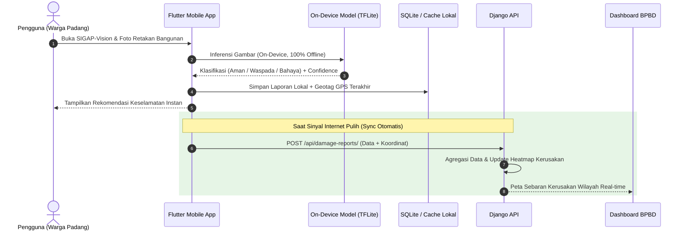
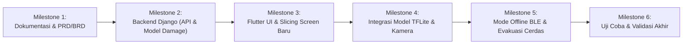

# DOKUMEN REVISI ARSITEKTUR & PANDUAN PENGEMBANGAN SIGAP
## Spesialisasi Tanggap Darurat Gempa Bumi & Tsunami Kota Padang

**Versi:** 2.1-Finalized  
**Status:** Disetujui untuk Implementasi — Semua Gap Arsitektur Telah Diselesaikan  
**Fokus Wilayah:** Kota Padang, Sumatera Barat (Zona Megathrust Mentawai & Sesar Semangko)  
**Target Platform:** Mobile (Flutter / Android) & Backend REST API (Django 5.2 + DRF)  

---

## 1. Latar Belakang & Rasionalisasi Pivot

### 1.1 Permasalahan Aplikasi Sebelumnya
Pada versi awal, SIGAP dirancang sebagai portal multi-bencana umum (banjir, longsor, cuaca ekstrem, gempa). Pendekatan umum ini memiliki kelemahan kritis:
1. **Kurang Mendalam:** Fitur hanya sebatas papan informasi pasif (menampilkan berita, peta umum, dan daftar nomor darurat).
2. **Tidak Mengatasi Golden Time:** Dalam gempa bumi besar yang berpotensi tsunami di pesisir Kota Padang, masyarakat hanya memiliki waktu **20–30 menit (*golden time*)** untuk menyelamatkan diri sebelum gelombang tiba.
3. **Korban Pascagempa Akibat Aftershocks:** Banyak korban jiwa terjadi bukan pada gempa awal, melainkan saat warga kembali ke dalam rumah untuk mengambil barang berharga atau tidur, lalu tertimpa reruntuhan gempa susulan (*aftershocks*) karena tidak mampu menilai apakah struktur rumahnya sudah rusak parah atau masih aman.
4. **Kelumpuhan Jaringan Telekomunikasi (*Zero-Connectivity*):** Belajar dari gempa Padang 2009, seluruh BTS seluler dan listrik padam. Aplikasi yang bergantung 100% pada koneksi internet server menjadi tidak berguna di saat genting.

### 1.2 Arah Baru Aplikasi
SIGAP bertransformasi menjadi **Super-App Tanggap Bencana Gempa Bumi & Tsunami Kota Padang**, yang berfokus pada **tiga pilar inovasi fungsional**:
1. **SIGAP-Vision:** Asesmen kerusakan struktur bangunan mandiri via kamera *on-device computer vision* (bisa offline).
2. **Smart Tsunami Evacuation & Golden Time Matrix:** Sistem panduan rute evakuasi vertikal (TES / Tempat Evakuasi Sementara) vs horizontal berbasis waktu tiba gelombang.
3. **Offline Emergency Mode & BLE Beacon:** Mode pemancar sinyal suar darurat tanpa internet menggunakan Bluetooth Low Energy (BLE) untuk korban terjebak reruntuhan.

---

## 2. Blueprint Layar Frontend (Acuan Tim FE Flutter)

Untuk mempermudah rekan pengembang Frontend (FE), berikut adalah peta pembagian layar:

### 2.1 Layar yang Dipertahankan (*Retained*)
| Layar | Path File | Catatan Integrasi |
|---|---|---|
| **Splash Screen** | `lib/features/splash/presentation/screens/splash_screen.dart` | Tetap digunakan untuk inisialisasi sesi token JWT dan pengecekan izin perangkat (kamera, lokasi, bluetooth). |
| **Login Screen** | `lib/features/auth/presentation/screens/login_screen.dart` | Autentikasi warga Padang dengan nomor HP / email. |
| **Register Screen** | `lib/features/auth/presentation/screens/register_screen.dart` | Pendaftaran warga dengan data kecamatan/kelurahan di Padang. |
| **Profile Screen** | `lib/features/profile/presentation/screens/profile_screen.dart` | Pengelolaan data pribadi dan riwayat laporan. |
| **Pengaturan Screen** | `lib/features/settings/presentation/screens/pengaturan_screen.dart` | Pengaturan preferensi notifikasi dan batas minimum magnitudo gempa untuk sirene otomatis. |
| **Keluarga Screen** | `lib/features/family/presentation/screens/keluarga_screen.dart` | Pelacakan status selamat anggota keluarga pascagempa (*Safe / Need Help*). |

---

### 2.2 Layar yang Dimodifikasi (*Modified*)

#### A. Beranda / Dashboard (`lib/features/dashboard/presentation/screens/home_screen.dart`)
- **Normal State:**
  - Kartu Status Seismik Terkini Kota Padang (Data BMKG real-time).
  - **Banner Utama Baru:** Tombol Aksi Cepat: *"Pindai Kerusakan Rumah (SIGAP-Vision)"*.
  - Status Keselamatan Keluarga Ringkas.
- **Emergency State (Saat Gempa Terjadi / Peringatan Tsunami Aktif):**
  - Background berubah ke mode kontras tinggi / waspada darurat (merah/oranye).
  - Countdown Timer *Golden Time* (estimasi tiba tsunami Padang).
  - Tombol Darurat Raksasa: **"PANDUAN EVAKUASI KE SHELTER TES"** dan **"AKTIFKAN SUAR SOS OFFLINE"**.

#### B. Layar Peringatan (`lib/features/alerts/presentation/screens/peringatan_screen.dart`)
- Dikhususkan 100% untuk data Seismologi & Tsunami:
  - Magnitudo, Kedalaman, Titik Episentrum, dan Jarak dari Kota Padang.
  - Skala MMI (*Modified Mercalli Intensity*) wilayah Kota Padang (misal: Padang Barat MMI VI).
  - Status Potensi Tsunami: *WASPADA, SIAGA, AWAS*, atau *TIDAK BERPOTENSI TSUNAMI*.
  - Rekomendasi tindakan instan berdasarkan level MMI.

#### C. Layar Peta Siaga (`lib/features/map/presentation/screens/peta_screen.dart`)
- Penambahan Layer Khusus Kota Padang:
  - **Layer TES (Tempat Evakuasi Sementara):** Menampilkan gedung-gedung bertingkat bersertifikasi evakuasi tsunami di Padang (gedung pemerintah, kampus, masjid kokoh 3+ lantai).
  - **Layer Zona Bahaya Tsunami:** Zona Merah (pesisir 0–1 km), Zona Kuning (1–2.5 km), Zona Hijau (aman / di atas jalur rel kereta & bypass).
  - **Layer Damage Heatmap:** Titik agregat laporan kerusakan bangunan warga yang telah terverifikasi.

---

### 2.3 Layar Baru yang Perlu Dibuat (*New Screens*)

#### A. `damage_camera_screen.dart` (SIGAP-Vision Scanner)
- **Komponen UI:**
  - Viewfinder Kamera dengan *guide overlay* berbentuk kotak target fokus (pilar/dinding retak).
  - Tombol Switch Torch/Flash (karena pascagempa listrik sering padam).
  - Tips Instruksi Cepat: *"Ambil foto pilar atau dinding dari jarak 1-2 meter. Pastikan retakan terlihat jelas."*
  - Tombol Shutter & Tombol Pilih dari Galeri.

#### B. `damage_result_screen.dart` (Hasil Asesmen Bangunan)
- **Komponen UI:**
  - Foto hasil jepretan dengan indikator bounding-box retakan.
  - **Status Card Risiko:**
    - 🟢 **AMAN (Minor):** Retak non-struktural pada plester dinding. Bangunan relatif aman dimasuki, tetap waspada.
    - 🟡 **WASPADA (Moderate):** Retak geser diagonal pada dinding bata. Batasi akses, hindari berada di dekat dinding tersebut.
    - 🔴 **BAHAYA KRITIS (Severe):** Kerusakan pada kolom/balok beton penyangga, tulangan terlihat, struktur miring. **PERINGATAN: JANGAN MASUKI RUMAH! RISIKO RUNTUH SAAT GEMPA SUSULAN.**
  - Skor Kepercayaan AI (*Confidence Score*).
  - Tombol Aksi:
    - *"Simpan Laporan & Sinkronkan ke BPBD"* (Menyimpan geotag lokal dan otomatis sync saat online).
    - *"Cari Titik Kumpul / Shelter Terdekat"* (Navigasi langsung ke peta).

#### C. `evacuation_guide_screen.dart` (Smart Tsunami Evacuation)
- **Komponen UI:**
  - Dynamic Countdown: Hitung mundur sisa waktu aman evakuasi.
  - Kartu Keputusan AI:
    - Logika: Jika waktu tempuh ke zona aman timur (Bypass) > estimasi gelombang tiba, arahkan ke TES vertikal terdekat.
    - Tampilan: *"Evakuasi Horizontal Tidak Memungkinkan! Evakuasi Vertikal ke TES Terdekat: Gedung X (350 meter)."*
  - Rute jalur bebas hambatan dan kompas penunjuk arah sederhana.

#### D. `emergency_beacon_screen.dart` (Mode Darurat Tanpa Sinyal)
- **Komponen UI:**
  - Tombol Toggle: **"Pancarkan Sinyal Suar SOS (BLE Beacon)"**.
  - Indikator Status Suar: Menampilkan status pemancaran (UUID darurat, status baterai, koordinat GPS terakhir yang tercatat).
  - Tombol **"Peluit Digital / Sirene Akustik"** (Memutar audio frekuensi tinggi berkala 85-90 dB).
  - Tombol **"Senter Strobo SOS"** (Lampu kilat HP berkedip dengan sandi Morse `... --- ...`).
  - Dark Mode Ultra Hemat Daya (Layar hitam pekat AMOLED untuk memperpanjang usia baterai HP).

---

### 2.4 Rekomendasi Dependencies & Plugin Flutter (Acuan FE)

Agar rekan tim FE tidak mengalami konflik versi atau kebingungan memilih pustaka:

| Kebutuhan Fitur | Paket Flutter (pub.dev) | Rekomendasi Versi | Catatan Penggunaan |
|---|---|---|---|
| **Kamera & Viewfinder** | `camera` | `^0.11.0` | Kontrol torch/senter, orientasi sensor, capture image stream |
| **Penyimpanan Lokal Offline** | `sqflite` + `path` | `^2.3.0` | Antrian laporan kerusakan offline (*offline queue*) |
| **Inference Model On-Device** | `tflite_flutter` | `^0.10.4` | Menjalankan inferensi model `model_v1.tflite` secara lokal |
| **Geolokasi & GPS** | `geolocator` | `^13.0.0` | Pengambilan koordinat GPS real-time & hitung jarak Haversine |
| **Pemancar Suar BLE** | `flutter_blue_plus` | `^1.34.0` | BLE Advertising & Scanning sinyal SOS darurat |
| **Sirene / Audio Darurat** | `audioplayers` | `^6.0.0` | Memutar audio peluit frekuensi tinggi 85-90 dB berkala |
| **Strobo Flashlight** | `torch_light` | `^1.1.0` | Mengontrol lampu kilat LED berkedip pola Morse `... --- ...` |
| **Peta Interaktif** | `flutter_map` + `latlong2` | *(Sudah terpasang)* | Merender GeoJSON polygon zona aman DEMNAS |
| **State Management (Rekomendasi)** | `flutter_bloc` | `^8.1.6` | Manajemen state darurat berbasis Finite State Machine (Event-Driven) |

#### 2.4.1 Izin Perangkat Android (`android/app/src/main/AndroidManifest.xml`)
Rekan FE wajib menambahkan izin berikut agar kamera dan BLE tidak crash pada Android 12+ (API 31+):
```xml
<!-- Kamera & Senter -->
<uses-permission android:name="android.permission.CAMERA" />
<uses-permission android:name="android.permission.FLASHLIGHT" />

<!-- Lokasi & GPS (Wajib untuk haversine & BLE) -->
<uses-permission android:name="android.permission.ACCESS_FINE_LOCATION" />
<uses-permission android:name="android.permission.ACCESS_COARSE_LOCATION" />

<!-- Bluetooth Low Energy (Android 12+) -->
<uses-permission android:name="android.permission.BLUETOOTH_ADVERTISE" />
<uses-permission android:name="android.permission.BLUETOOTH_SCAN" android:usesPermissionFlags="neverForLocation" />
<uses-permission android:name="android.permission.BLUETOOTH_CONNECT" />
```

#### 2.4.2 Strategi Anti-Blocker Frontend: `MockDamageClassifier`
Agar tim Frontend **TIDAK TERHAMBAT** menunggu proses training model `.tflite` selesai:
- Tim FE dianjurkan membuat class `MockDamageClassifier` yang mengembalikan hasil acak/tetap (*dummy prediction: 85% critical*) saat tombol shutter ditekan.
- Dengan cara ini, UI kamera, kartu hasil, navigasi darurat, dan antrian SQLite bisa diselesaikan 100% pada Sprint 1 tanpa perlu menunggu file `.tflite`.


---

## 3. Arsitektur Teknis & Alur Data

### 3.1 Alur Sistem SIGAP-Vision (Camera Assessment)



### 3.2 Spesifikasi Model AI On-Device
- **Tipe Model:** MobileNetV3 / EfficientNet-Lite yang di-*fine-tune* pada dataset *Concrete Crack & Structural Damage*.
- **Ukuran Model:** < 8 MB (Format `.tflite`), dioptimalkan untuk perangkat Android *low-to-mid range*.
- **Output Kelas:**
  1. `crack_non_structural` (Label: Ringan / Aman)
  2. `crack_structural_wall` (Label: Sedang / Waspada)
  3. `severe_column_failure` (Label: Berat / Bahaya Kritis)

---

## 4. Perubahan Skema Database Backend (Django)

Untuk mendukung agregasi laporan kerusakan warga pascagempa, ditambahkan model baru pada modul `alerts` atau modul baru `damage_assessment`:

### Model: `DamageReport`
```python
class DamageReport(models.Model):
    class DamageLevel(models.TextChoices):
        MINOR = 'minor', 'Ringan (Non-Struktural)'
        MODERATE = 'moderate', 'Sedang (Waspada Dinding)'
        CRITICAL = 'critical', 'Kritis (Bahaya Struktur/Kolom)'

    id = models.UUIDField(primary_key=True, default=uuid.uuid4, editable=False)
    user = models.ForeignKey(settings.AUTH_USER_MODEL, on_delete=models.CASCADE, related_name='damage_reports')
    latitude = models.FloatField()
    longitude = models.FloatField()
    damage_level = models.CharField(max_length=20, choices=DamageLevel.choices)
    confidence_score = models.FloatField()
    description = models.TextField(blank=True, null=True)
    image_url = models.URLField(blank=True, null=True) # Opsional di-upload saat koneksi stabil
    is_verified_by_officer = models.BooleanField(default=False)
    created_at = models.DateTimeField(auto_now_add=True)
    synced_at = models.DateTimeField(auto_now=True)

    class Meta:
        ordering = ['-created_at']
```

---

## 5. Kontrak API Baru (Django REST Framework)

| Method | Endpoint | Deskripsi | Hak Akses |
|---|---|---|---|
| `POST` | `/api/damage-reports/` | Menerima sinkronisasi laporan kerusakan hasil scan warga (`multipart/form-data` dengan opsional file `image`, atau `application/json`) | `IsAuthenticated` |
| `GET` | `/api/damage-reports/my/` | Riwayat laporan kerusakan milik pengguna saat ini | `IsAuthenticated` |
| `GET` | `/api/damage-reports/heatmap/` | Data agregat titik koordinat kerusakan per kelurahan untuk layer peta | `AllowAny` |
| `GET` | `/api/shelters/tsunami/` | Daftar titik shelter TES resmi di Kota Padang beserta kapasitas | `AllowAny` |
| `GET` | `/api/officer/damage-reports/pending/` | Daftar laporan kerusakan yang menunggu verifikasi petugas | `IsAuthenticated (Officer)` |
| `PATCH` | `/api/officer/damage-reports/{id}/verify/` | Verifikasi/tolak laporan kerusakan oleh petugas BPBD | `IsAuthenticated (Officer)` |


---

## 6. Roadmap Implementasi Bertahap



Dengan spesifikasi ini, implementasi dapat dijalankan secara paralel antara tim Backend (mempersiapkan endpoint dan model) dan tim Frontend (mempersiapkan layar UI kamera dan integrasi state).

### 6.2 Pembagian Sprint & Backlog Siap Eksekusi (Sprint Plan 1–3)

#### 🚀 Sprint 1: Backend API, Model Data, & Pre-processing Spasial
- **BE-01:** Buat Django app `backend/apps/damage_assessment/` beserta migrasi model `DamageReport` dan `SafeZone`.
- **BE-02:** Implementasi service sync/proxy data BMKG Open API (`autogempa.json` dan `gempadirasakan.json`).
- **BE-03:** Siapkan initial fixture `backend/fixtures/safe_zones.json` (polygon GeoJSON zona dataran tinggi aman Kota Padang: Bukit Lampu, Indarung, Limau Manis, Bukit Gado-Gado, Bypass Timur) agar tim tidak terhambat GIS manual.
- **BE-04:** Implementasi endpoint REST: `POST /api/damage-reports/`, `GET /api/damage-reports/heatmap/`, `GET /api/shelters/tsunami/`, dan endpoint officer verifikasi.
- **FE-01:** Install dependencies baru di `pubspec.yaml` (`camera`, `geolocator`, `tflite_flutter`, `sqflite`, dll.).
- **FE-02:** Slicing UI `damage_camera_screen.dart` (viewfinder, flash control, guide framing overlay).

#### 🚀 Sprint 2: Integrasi Model Vision & Alur Asesmen Kerusakan
- **ML-01:** Siapkan model pre-trained `model_v1.tflite` (klasifikasi retakan 3 kelas: minor, moderate, critical) dan letakkan di `assets/models/`.
- **FE-03:** Integrasi `tflite_flutter` untuk inferensi on-device pada hasil foto kamera (< 2 detik).
- **FE-04:** Slicing & integrasi `damage_result_screen.dart` dengan mandatory disclaimer AI (3 detik timer) & status card risiko.
- **FE-05:** Implementasi antrian penyimpanan lokal SQLite & logika auto-sync ke endpoint backend saat online.
- **FE-06:** Modifikasi `home_screen.dart` (Action Banner SIGAP-Vision & Emergency State toggle).

#### 🚀 Sprint 3: Evakuasi Tsunami, Mode BLE Offline, & Polish
- **FE-07:** Slicing & logika `evacuation_guide_screen.dart` (Golden Time Countdown + rute elevasi aman).
- **FE-08:** Modifikasi layer peta pada `peta_screen.dart` (tampilkan layer polygon zona aman & heatmap kerusakan).
- **FE-09:** Slicing & integrasi `emergency_beacon_screen.dart` (BLE beacon advertiser, sirene audio, strobo senter).
- **QA-01:** Testing offline simulation (mode pesawat): verifikasi kamera, TFLite inference, SQLite queue, dan BLE broadcast.
- **QA-02:** Verifikasi sinkronisasi backend dan akurasi heatmap setelah internet kembali online.


---

## 7. Keputusan Arsitektur Final (Gap Resolution)

### 7.1 Sumber Data Zona Aman Evakuasi Tsunami (G-01 — Selesai)
Tidak tersedia data shelter TES resmi dari BPBD dalam format digital. Strategi yang diadopsi adalah **Pendekatan Berbasis Elevasi (*Elevation-Based Safe Zone*):**

- **Sumber Data Elevasi:** DEMNAS (Digital Elevation Model Nasional), produk BIG (Badan Informasi Geospasial) Indonesia, resolusi ~8 meter. Data ini gratis, paling akurat untuk wilayah pesisir Indonesia, dan lebih baik dari SRTM global untuk konteks lokal.
- **Kriteria Zona Aman:** Kawasan dengan elevasi **> 10 meter dari permukaan laut (mdpl)** ditetapkan sebagai zona aman tsunami berdasarkan model *bathtub* run-up konservatif untuk skenario Megathrust Mentawai.
- **Format Data di Aplikasi:** Data elevasi Kota Padang di-*pre-process* secara offline menjadi **kumpulan polygon GeoJSON statis** yang merepresentasikan zona aman (hijau), zona waspada (kuning 5–10 mdpl), dan zona bahaya (merah < 5 mdpl). Data GeoJSON ini disimpan sebagai aset statis di backend Django dan di-*bundle* di aplikasi Flutter.
- **Keuntungan:** Tidak bergantung pada data pihak ketiga yang bisa usang. Dapat diperbarui kapan saja dengan data elevasi terbaru.

### 7.2 Sumber Data & Logika Golden Time (G-02 — Selesai)
**Sumber Utama:** BMKG Open Data API (InaTEWS) — tanpa autentikasi, gratis.

| Endpoint BMKG | Fungsi |
|---|---|
| `https://data.bmkg.go.id/DataMKG/TEWS/autogempa.json` | Gempa terakhir real-time |
| `https://data.bmkg.go.id/DataMKG/TEWS/gempaterkini.json` | 15 gempa ≥ M5.0 terkini |
| `https://data.bmkg.go.id/DataMKG/TEWS/gempadirasakan.json` | Gempa dirasakan + data MMI per wilayah |
| Field `Shakemap` di payload | URL gambar peta guncangan wilayah |
| Field `Potensi` di payload | Status tsunami (`Berpotensi` / `Tidak Berpotensi`) |

**Arsitektur Integrasi:** Backend Django bertindak sebagai **proxy + cache BMKG** (polling tiap 60 detik). Flutter tidak memanggil BMKG secara langsung — semua permintaan melalui API SIGAP. Ini memungkinkan:
1. Filter relevansi (hanya gempa yang berpotensi berdampak di radius Kota Padang).
2. Cache untuk mode offline Flutter.
3. Atribusi BMKG sebagai sumber resmi wajib ditampilkan di UI.
4. **Mekanisme Scheduler:** Menggunakan pustaka `django-apscheduler` (in-process, tanpa ketergantungan broker Redis/Celery terpisah yang memakan biaya/RAM di server). Job berjalan periodik tiap 60 detik memanggil helper `sync_bmkg_data()`, sekaligus menyediakan endpoint fallback `POST /api/internal/sync-bmkg/` untuk external cron trigger.


**Logika Kalkulasi Golden Time:**
```
Jarak episentrum ke garis pantai Padang diketahui.
Kecepatan rambat tsunami di laut dalam rata-rata ± 700 km/jam.
Estimasi waktu tiba = Jarak (km) ÷ 700 × 60 (menit).
Jika field `Potensi` = "Berpotensi Tsunami" → Timer Golden Time diaktifkan.
```
Timer dimulai sejak notifikasi diterima. Perlu disclaimer bahwa ini perkiraan, bukan peringatan resmi BMKG.

### 7.3 Lokasi Modul Backend (G-03 — Selesai)
**Keputusan: Modul Django Baru — `damage_assessment`**

Lokasi: `backend/apps/damage_assessment/`

Alasan pemisahan dari modul `alerts`:
- Bounded context yang berbeda: `alerts` mengelola data seismik masuk dari BMKG (read-heavy), sedangkan `damage_assessment` mengelola laporan yang dikirim warga (write-heavy + aggregation).
- Memudahkan pengaturan permission: petugas BPBD hanya perlu akses ke `damage_assessment` untuk verifikasi, tanpa perlu menyentuh `alerts`.

### 7.4 Disclaimer & Batas Tanggung Jawab AI (G-06 — Selesai)
Teks disclaimer wajib berikut harus tampil di UI **sebelum hasil asesmen ditampilkan** dan harus tercantum di PRD/BRD secara eksplisit:

> *"Hasil analisis ini dihasilkan oleh model kecerdasan buatan (AI) dan **bukan merupakan pengganti penilaian struktural oleh ahli teknik sipil atau insinyur bangunan bersertifikat**. Gunakan hasil ini hanya sebagai panduan tindakan darurat awal. SIGAP tidak bertanggung jawab atas keputusan yang diambil berdasarkan hasil analisis ini."*

Implementasi di UI: Layar `damage_result_screen.dart` wajib menampilkan banner disclaimer yang tidak bisa di-dismiss selama minimal 3 detik sebelum kartu hasil muncul.

---

## 8. Arsitektur ML Pipeline SIGAP-Vision (Production-Ready)

### 8.1 Dua Tahap Deployment Model

```
TAHAP 1 — PROTOTYPE (Tersedia dalam 1-2 minggu, bisa langsung diintegrasikan):
  Sumber: Dataset publik Kaggle/HuggingFace
  ├── Concrete Crack Detection Dataset (40.000+ gambar)
  └── Structural Damage Dataset (berbasis PEER / ATC-20 labeling)
  
  Training: Fine-tune EfficientNet-Lite0 / MobileNetV3-Small
             di Google Colab (gratis, GPU T4)
  Output: model_v1.tflite (~5-8 MB)
  Deploy: Di-bundle sebagai aset di dalam APK Flutter (assets/models/)

TAHAP 2 — PRODUCTION (Setelah MVP, iteratif):
  Tambahan data lokal: Foto bangunan tipikal Padang 
                       (dinding bata merah, kolom beton sederhana, rumah panggung Minang)
  Fine-tuning model v1 → model v2+ dengan akurasi lebih tinggi untuk konteks lokal
  Deploy: OTA update via backend SIGAP (endpoint download model terbaru)
          tanpa perlu update APK baru
```

### 8.2 Strategi Deploy Model: Hybrid Bundle + OTA

| Strategi | Kapan Aktif | Detail |
|---|---|---|
| **Model Bundled (v1)** | Selalu (fallback) | File `.tflite` disimpan di `assets/models/sigap_vision_v1.tflite` di dalam APK. Tidak butuh internet. |
| **Model OTA (v2+)** | Saat internet tersedia | App memeriksa endpoint `/api/model/latest/` saat startup. Jika ada versi baru, download otomatis ke penyimpanan lokal HP. |
| **Active Model** | Runtime | App selalu menggunakan model dengan versi tertinggi yang tersedia secara lokal. |

### 8.3 Label Output Model & Mapping ke UI

| Label Internal | Tampilan UI | Aksi yang Disarankan |
|---|---|---|
| `crack_non_structural` | 🟢 **AMAN** — Retak Non-Struktural (Plester) | *"Bangunan relatif aman dimasuki. Pantau perkembangan dan hindari area retak."* |
| `crack_structural_wall` | 🟡 **WASPADA** — Retak Geser Dinding Bata | *"Batasi akses ke area ini. Jangan berlindung di bawah dinding tersebut saat gempa susulan."* |
| `severe_column_failure` | 🔴 **BAHAYA KRITIS** — Kerusakan Kolom/Balok | *"JANGAN MASUKI BANGUNAN. Risiko runtuh akibat gempa susulan sangat tinggi. Segera menuju titik kumpul aman."* |

### 8.4 Non-Functional Requirements (NFR) Fitur Baru (G-05 — Selesai)

| Kode | Parameter | Target | Catatan |
|---|---|---|---|
| **NFR-AI-01** | Waktu inferensi TFLite | < 2 detik pada Snapdragon 625 (perangkat *low-mid range*) | Gunakan EfficientNet-Lite0 untuk menjamin kecepatan |
| **NFR-AI-02** | Ukuran model bundled | < 8 MB | Dihitung di luar ukuran APK Flutter baseline |
| **NFR-AI-03** | Resolusi gambar input | Minimum 480×480px, maksimum 4000×4000px | App otomatis resize ke 224×224 sebelum inferensi |
| **NFR-BLE-01** | Radius deteksi sinyal BLE Beacon | 30–70 meter (target: 50 meter LOS) | Bergantung pada hardware perangkat & obstruksi fisik |
| **NFR-BLE-02** | Pemancaran BLE saat layar terkunci | Harus tetap aktif (*background service*) | Gunakan `flutter_foreground_task` + BLE plugin |
| **NFR-BLE-03** | Konsumsi daya BLE mode darurat | Tidak melebihi 15% baterai per jam | Mode advertise interval 500ms |

---

## 9. Alur Verifikasi Laporan oleh Petugas BPBD (G-07 — Selesai)

Petugas BPBD memiliki role `officer` di sistem. Alur verifikasi:

```
Warga mengirim laporan → Backend simpan (is_verified = False)
                              │
                              ▼
                    Dashboard BPBD / Panel Admin
                    (Endpoint: GET /api/officer/damage-reports/pending/)
                              │
                   ┌──────────┴──────────┐
                   ▼                     ▼
         Verifikasi Laporan          Tolak Laporan
  PATCH /api/officer/damage-reports/{id}/verify/    
  → is_verified_by_officer = True     → Laporan di-flag atau dihapus
  → Masuk ke heatmap publik           
```

Endpoint tambahan untuk modul `damage_assessment`:
- `GET /api/officer/damage-reports/pending/` — Laporan menunggu verifikasi (officer only)
- `PATCH /api/officer/damage-reports/{id}/verify/` — Verifikasi laporan (officer only)


